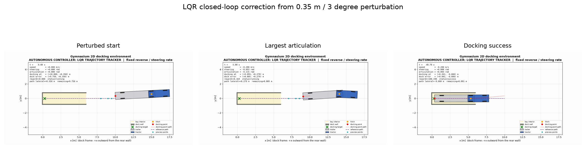
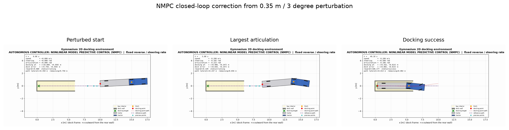
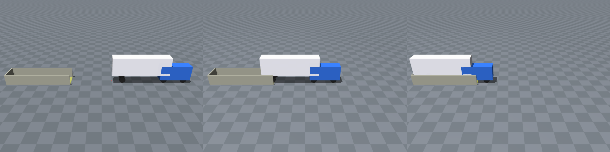
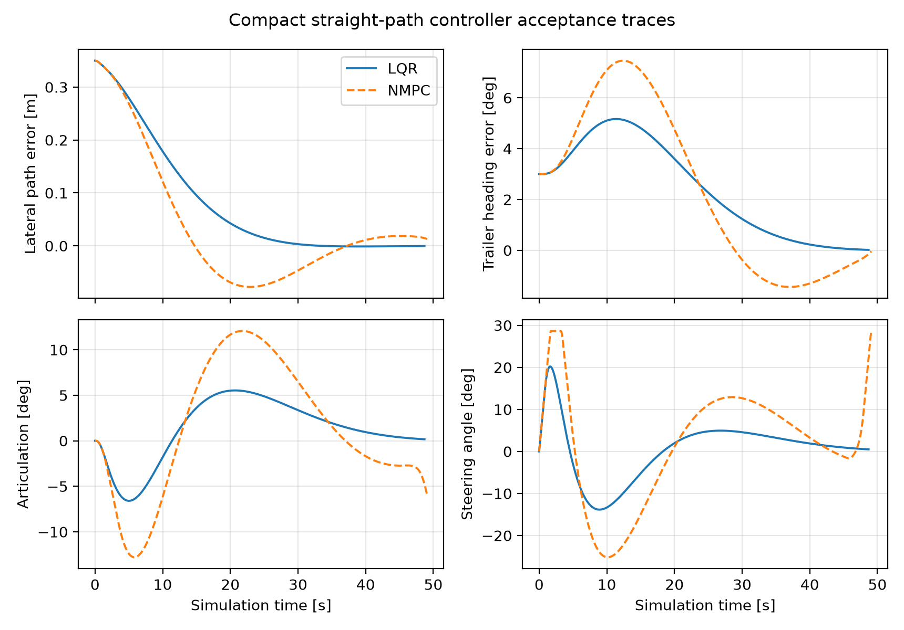
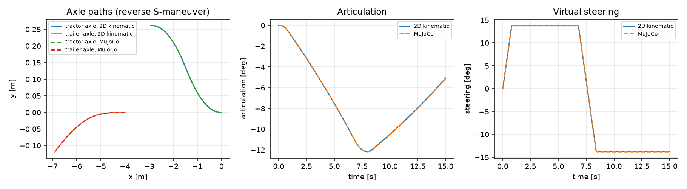

## 1. Summary

Phase 1 delivers an operational 2D Gymnasium environment, an operational 3D
MuJoCo plant, and two end-to-end closed-loop controllers in the 2D task. The
LQR and basic NMPC demonstrations begin from a 0.35 m lateral and 3° heading
perturbation, visibly steer the articulated vehicle, and reach the configured
docking-success event.

| Rubric / project item | Current status | Evidence |
|---|---|---|
| 2D simulation and task operational | Done | `TrailerDocking-v0`, renderer, safety events, reward, and API checker |
| 3D simulation operational | Done | Configuration-generated MuJoCo vehicle, dock, contacts, and shared adapter |
| Programming setup operational | Done | 274 tests pass; 89.37% branch-aware coverage; Ruff and strict mypy pass |
| Closed-loop controller integration | Done at vertical-slice level | LQR and basic NMPC dock from a deterministic perturbed straight-path start |
| PPO controller | Planned | Parallel implementation must retain the shared observation/action contract |
| Formal controller comparison | Planned | Curved paths, randomized starts, common seeds, repeated trials, and ablations |
| 2D-to-3D controller transfer | Planned | Plant-level parity exists; MuJoCo task-event/controller parity does not |

The controller runs in this report are **engineering acceptance tests**, not a
performance comparison. They use one deterministic, tuned straight-path case.
They do not establish robustness, arbitrary-pose planning, or controller
superiority.

The required Phase 1 simulation, programming, and environment setup is
complete and provides the shared foundation for PPO training and comparative
experiments in Phase 2.

## 2. System implemented

The task is to reverse a tractor with one semitrailer into a known loading bay
without collision or jackknife. The planned research comparison is between a
trajectory-relative PPO controller and NMPC under the same task definition.

- **2D platform:** custom low-speed kinematic plant inside Gymnasium for rapid
  training and controlled experiments.
- **3D platform:** MuJoCo vehicle and dock generated from the shared vehicle
  configuration for physics-based demonstration and later transfer testing.
- **Research action:** one normalized steering-rate action at a fixed reverse
  speed. Manual teleoperation has a separate speed-enabled mode and does not
  redefine the research interface.
- **Controller period:** 0.10 s.
- **Reference representation:** target-to-start polyline with projection,
  progress, signed lateral error, heading error, and local preview samples.
- **Observation:** 21 normalized path-relative values, including pose errors,
  articulation, steering state, progress, docking error, and preview points.
- **Events:** success, collision, jackknife, workspace exit, and timeout are
  evaluated independently from reward.

The compact baseline uses a 1.90 m tractor wheelbase, a 4.00 m nominal
hitch-to-trailer-axle length, ±0.50 rad steering, ±0.30 rad/s steering rate,
and a −0.20 m/s reverse target. Docking requires pose error within 0.10 m and
3°, complete trailer containment, no collision, and no jackknife.

### 2.1 Programming setup

The project is implemented as an installable Python package with versioned
dependencies and YAML-based vehicle, dock, and task configurations. Automated
verification includes 274 passing tests with 89.37% branch-aware coverage.
Ruff linting and strict mypy type checking also pass. These checks cover the
shared vehicle core, kinematic and MuJoCo backends, Gymnasium API, task events,
controller integration, rendering, and artifact generation.

### 2.2 Continuity with the proposal

There are no material deviations from the proposed technical setup. The
project retains the custom 2D Gymnasium environment for controller development,
MuJoCo for the 3D demonstration and transfer stage, PPO as the principal
learning method, and NMPC as the model-based comparison method. The fixed
reverse-speed and steering-rate action, trajectory-relative observation,
collision and jackknife checks, and shared evaluation interface also remain
unchanged. LQR is included as an additional deterministic integration baseline
and does not replace the planned PPO–NMPC comparison. MuJoCo development was
completed earlier than originally scheduled, changing the implementation order
without changing the project scope.

## 3. Implemented controllers

### 3.1 Trajectory-error LQR

`TrajectoryLQRController` numerically linearizes the same RK4 kinematic plant
used by the environment about straight reversing. Its local state contains
trailer docking-point lateral error, tractor heading error, trailer heading
error, and steering angle. A discrete Riccati iteration produces a physical
steering-rate command, which is normalized through the shared action contract.

This is a deterministic integration baseline. It verifies path-error signs,
feedback authority, action normalization, articulated motion, and terminal
events. General curved-path performance has not yet been established.

### 3.2 Basic NMPC

`BasicNMPCController` uses CasADi/IPOPT to predict the nonlinear articulated
model over 40 controller periods. It penalizes trailer docking-point position
and heading error, tractor heading, articulation, steering angle, and steering
rate. Steering rate is the only optimized control and speed remains fixed at
the configured reverse target.

The optimization enforces initial state, discrete dynamics, steering-angle,
steering-rate, and articulation constraints. It applies the first action,
warm-starts the next solve, and records solver failures. Collision is still
handled by the environment and is not yet part of the prediction constraints.

### 3.3 Shared convention for PPO

The controller interface provides state/path context to model-based methods
and requires every method to return the same normalized scalar steering-rate
action. PPO can train directly from the Gymnasium observation, but its
evaluation adapter must obey this action contract. Vehicle/dock/task
configuration fingerprints and the shared environment events align future
PPO runs with LQR and NMPC.

## 4. Evaluation protocol and controller evidence

The acceptance reference is a straight path defined independently of reset
pose. The tractor and trailer start aligned with each other, but displaced
0.35 m laterally and rotated 3° from that reference. Therefore a controller
must steer and create articulation; a constant zero steering-rate command does
not satisfy this perturbed case.

| Scenario | Controller | Steps | Time (s) | Final lateral error (m) | Final heading error (deg) | Maximum articulation (deg) | Solver failures |
|---|---:|---:|---:|---:|---:|---:|---:|
| Compact | LQR | 487 | 48.7 | −0.0004 | 0.0175 | 6.59 | 0 |
| Compact | NMPC | 491 | 49.1 | 0.0128 | −0.0384 | 12.79 | 0 |

Both runs terminate in docking success without collision or jackknife.
NMPC reports no solver failure. Their different transients are visible, but a
single tuned scenario cannot support a ranking between the methods.

The MuJoCo 3D environment is also operational. The figure below shows the
articulated vehicle at the start, during motion, and at rear-wall contact under
a fixed straight-reverse command. The scene includes the generated
tractor–trailer, loading bay, hitch joint, Ackermann steering, driven rear
wheels, cameras, and contact geometry. This is 3D setup evidence, not an LQR or
NMPC result.

The two controller montages show the initial condition, maximum-articulation
point, and terminal success. The numerical plot records lateral error,
trailer-heading error, articulation, and steering angle throughout both runs.

## 5. Simulator and environment validation

Plant and environment validation covers the following behavior:

- The 2D environment passes Gymnasium's API checker.
- Tests cover straight and constant-steering motion, articulation response,
  angle wrapping, rigid geometry reconstruction, limits, deterministic replay,
  and timestep convergence.
- Collision, jackknife, success, workspace, and timeout paths are tested.
- A 1,000-step randomized stress rollout and all configured trailer lengths are
  covered by automated tests.
- The configuration-generated MuJoCo model exposes the shared command/state
  contract and validates timing, steering sign, hitch geometry, and contacts.
- Under the same 150-command, 15 s low-speed reverse S-maneuver, the maximum
  2D/MuJoCo tractor-position gap is 0.008 m and the maximum articulation gap is
  0.0009 rad.

The verification suite contains 274 passing tests and 89.37% branch-aware coverage.
Ruff, strict mypy, executable specification conformance, and generated-MuJoCo
model checks pass.

## 6. Experimental repeatability

The controller demonstrations use a deterministic seed, the same compact
vehicle and dock definitions, the same straight reference path, the same
initial perturbation, and the same fixed-speed steering-rate interface.
Vehicle, dock, and task definitions are versioned and fingerprinted so that the
scenario can be reproduced without relying on manually entered parameters.

The evaluated software stack uses Python 3.11, Gymnasium 1.4, CasADi 3.8, and
NumPy 2.4. Automated tests verify the vehicle model, task events, controller
integration, rendering, video generation, and 2D/MuJoCo plant comparison.

## 7. Limitations and next phase

1. The reference path is manually defined and straight. No global planner yet
   connects an arbitrary yard pose to a selected loading door.
2. Curved-path and randomized-start validation is not complete for either
   controller.
3. NMPC does not yet include predicted footprint collision constraints.
4. PPO training and evaluation remain planned.
5. The MuJoCo plant is validated, but the Gymnasium task events and controllers
   have not yet been applied end to end to MuJoCo.
6. The two acceptance runs are deterministic demonstrations, not formal
   experiments or ablations.

The next implementation gate is a versioned scenario suite with straight,
curved, and randomized starts. LQR/geometric, NMPC, and PPO must then use common
seeds and saved records. Required metrics include success, collision,
jackknife, terminal pose error, path error, maximum articulation, control
effort, and controller compute time. Formal 2D comparisons precede MuJoCo
controller transfer.

With the vehicle model, Gymnasium task, safety events, reference-path
representation, controller interface, and initial baselines operational, the
project is ready to proceed to PPO training, curved and randomized scenarios,
formal controller evaluation, and subsequent MuJoCo transfer testing.

## 8. Conclusion

Phase 1 establishes the foundational simulation and control stack for
tractor–semitrailer reverse docking. The shared vehicle specification, planar
kinematic model, Gymnasium task, and MuJoCo environment are operational and
supported by automated verification. In the 2D environment, both the
trajectory-error LQR controller and the basic NMPC controller complete a
perturbed straight-path docking scenario through the common fixed-speed,
steering-rate control interface. The MuJoCo results demonstrate operational 3D
vehicle motion and contact handling; closed-loop controller transfer to MuJoCo
remains future work.

These results provide an end-to-end controller integration baseline rather
than a formal comparison of controller performance. The next phase will extend
the evaluation to curved reference paths, randomized initial conditions, PPO
training, robustness studies, controller ablations, and eventual 2D-to-3D
transfer without changing the shared vehicle and task contracts.
