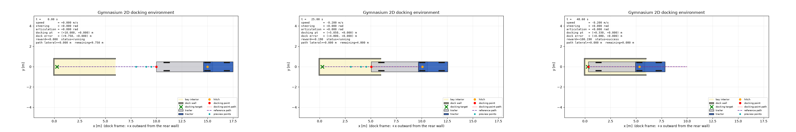
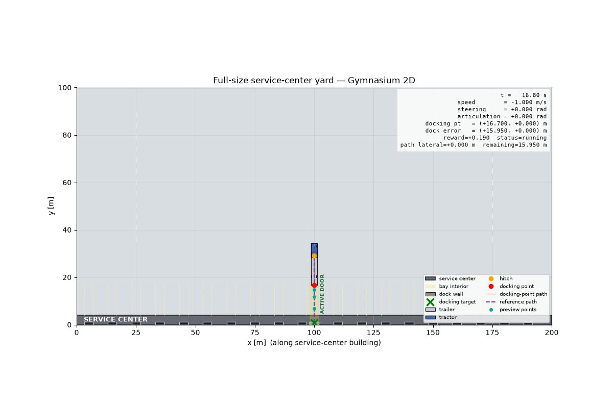
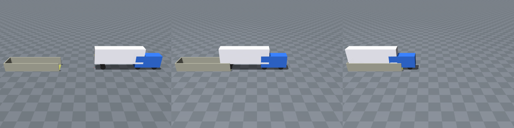
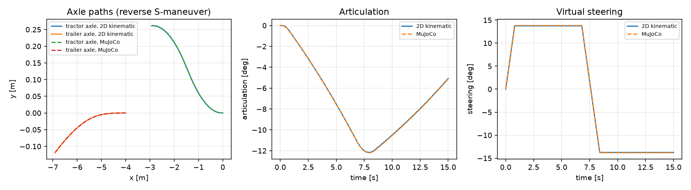

## 1. Summary

The project setup is complete. The simulation, the programming environment,
and the task environment all run from the `main` branch of the team
repository, and an automated check suite confirms it on every push.

| Rubric item | Status | Evidence |
|---|---|---|
| Simulation operational | Done | A 2D kinematic simulator and a 3D MuJoCo simulator both run the same vehicle and agree to within 8 mm over a 15 s reverse maneuver (Section 4.3) |
| Programming setup operational | Done | One-command install; 266 automated tests pass; lint, strict type checking, and continuous integration are green (Section 3) |
| Environment setup operational | Done | The Gymnasium task `TrailerDocking-v0` passes the Gymnasium API checker and completes a collision-free docking episode (Section 4.1) |
| Evidence of progress | Done | Three recorded animations, four figures, and a script that regenerates all of them (Section 4) |
| No deviation from the proposed setup | Kept | Same platform, language, methods, and task as the proposal; additions and open items are listed in Section 6 |

What does not exist yet: no controller has been trained or evaluated. Every
rollout shown in this report uses a fixed open-loop command to prove that the
simulators and environment work. NMPC and PPO are Phase 2 work.

All numbers in this report were re-measured on 13 November 2026 against `main`
at revision `437c2bc` (Windows 11, Python 3.12.0, Gymnasium 1.4.0, MuJoCo
3.17.0, NumPy 2.5.4).

Repository: <https://github.com/nandan-prince/RL-based-Autonomous-Tractor-Trailer-Reverse-Docking>

## 2. What the project is

The task is to reverse one tractor with one semitrailer into a known loading
bay without hitting the walls or jackknifing. The research question from the
proposal is whether a PPO controller that observes the reference path ahead of
the trailer can do this reliably, and how it compares with nonlinear model
predictive control (NMPC) under varied start poses, trailer lengths, and
observation noise.

The proposal committed to this setup, and the repository implements it:

- **Platform.** A fast custom 2D Gymnasium environment for training and the
  quantitative comparison, and MuJoCo for the 3D model and demonstration.
- **Language and tools.** Python 3, Gymnasium, MuJoCo, NumPy, Matplotlib,
  pytest, YAML configuration, Git and GitHub.
- **Control interface.** One action: a bounded steering rate, at a fixed
  reverse speed of 0.2 m/s. Both controllers will use it.
- **Pipeline.** Reference path, then controller, then safety supervisor, then
  simulator, as drawn in the proposal.

## 3. Programming setup

### 3.1 Installation

The project is an installable Python package with pinned dependency ranges.
Setup is two commands from the repository root:

```bash
python3 -m venv .venv
.venv/bin/pip install -e '.[dev,mujoco,viz]'
```

### 3.2 Repository layout

```text
configs/      Versioned YAML for vehicles, docks, and the Gymnasium task
docs/design/  Frozen vehicle and environment specification, architecture, MuJoCo audit
src/trailer_docking/
  core/           Shared state, command, geometry, strict configuration loading
  simulators/     kinematic/ (2D) and mujoco/ (3D) behind one simulator protocol
  paths/          Reference paths, path-relative errors, preview points
  observations/   Controller-facing observation vector
  safety/         Collision, jackknife, and command supervision
  environments/   Gymnasium task, renderer, keyboard viewer
  controllers/    Placeholders for the tracker, NMPC, and PPO
  evaluation/     Placeholders for scenarios, metrics, and the rollout runner
tests/        Unit and integration tests
paper/        IEEE-format LaTeX report, maintained alongside the code
research/     Literature index, decision log, open questions
```

On `main` this is about 6,000 lines of Python source and 29 test files, built
through pull requests from both team members.

### 3.3 Verification gates

Continuous integration (GitHub Actions) runs six gates on every push and pull
request. The last eight runs, including the three most recent merges to
`main`, all passed. The same gates were re-run locally for this report:

| Gate | Command | Result |
|---|---|---|
| Lint | `ruff check src tests` | All checks passed |
| Static types | `mypy` (strict) | No issues in 31 source files |
| Tests | `pytest --cov` | 266 passed in 11 s |
| Coverage | branch-aware, 85 % required | 91.52 % |
| Specification conformance | `python -m trailer_docking.validation.vehicle_spec` | 7 of 7 checks pass |
| Generated MuJoCo model is current | `python -m trailer_docking.simulators.mujoco.builder` | Both model files up to date |

### 3.4 One specification for both simulators

Both simulators read the same versioned YAML files, so they cannot drift apart
in geometry or limits. The specification document
(`docs/design/vehicle-and-environment-specification.md`) freezes coordinate
and sign conventions, the state and command contracts, timing, and the
definition of docking success.

| Parameter | Value (`compact-semitrailer-v1`, `nominal-dock-v1`) |
|---|---|
| Tractor wheelbase / body | 1.90 m / 2.90 m by 1.00 m |
| Trailer hitch-to-axle length | 4.00 m nominal; 2.00 m and 5.00 m variants |
| Steering angle / steering rate limits | 0.50 rad / 0.30 rad/s |
| Speed / acceleration limits | 0.20 m/s forward and reverse / 0.40 m/s² |
| Articulation warning / jackknife thresholds | 35° / 45° |
| Controller period | 0.10 s (5 substeps in 2D, 50 physics steps in MuJoCo) |
| Bay interior | 1.50 m wide, 6.00 m deep |
| Docking success | Within 0.10 m and 3° of the target, trailer fully inside the bay, no collision, no jackknife |

Each configuration has a SHA-256 fingerprint that the environment reports in
every step, so later experiment results can be tied to exact inputs.

## 4. Evidence that the simulation and environment run

Everything in this section is produced by `reports/phase1/make_evidence.py`,
which only calls the package's public simulators and environment. Its raw
output is saved in `reports/phase1/evidence_summary.json`.

### 4.1 2D Gymnasium environment

`TrailerDocking-v0` combines the 2D kinematic simulator with a reference
path, a 21-element path-relative observation, footprint collision checking,
jackknife detection, docking success, a decomposed reward, and a renderer.

- Gymnasium's own API checker passes.
- The observation is 21 values bounded to [-1, 1]; the action is one
  normalized steering rate.
- A constant straight reverse from the default start reaches docking success
  after 486 control steps (48.6 s simulated), with no collision and a final
  longitudinal error of 0.08 m.
- With uniform random steering from 20 seeded random starts, every episode
  ended through the safety logic: 14 by collision and 6 by jackknife. This
  shows that the termination events fire. It is also a first indication that
  the task is not solved by chance.



Animation: `figures/gym2d_compact_straight_reverse.gif`

A second, separately versioned scenario shows the same environment at
full scale: a 14 m trailer in a 200 m by 100 m service-center yard with 20
doors. Its straight-reverse run also reaches docking success, after 325 steps.
The viewer accepts keyboard driving in both scenarios.

{ width=70% }

Animation: `figures/gym2d_service_center_straight_reverse.gif`

### 4.2 3D MuJoCo simulation

The MuJoCo model is generated from the same YAML files: a tractor on a free
joint, a trailer on a hitch yaw joint, Ackermann front steering, driven rear
wheels, and a walled loading bay (11 bodies, 10 joints, 4 actuators, 2 ms
physics step). An adapter exposes the same command and state contract as the
2D simulator.

In the run below, a fixed reverse command backs the vehicle straight into the
bay. The trailer touches the rear wall after 503 control steps, and the
simulator reports the contact. The trailer stays centered and the articulation
stays at zero throughout.



Animation: `figures/mujoco_straight_reverse.gif`

### 4.3 The two simulators agree

The same 150 open-loop commands (a 15 s reverse S-maneuver at 0.2 m/s) were
sent to both simulators.

| Quantity | Largest gap between 2D and MuJoCo |
|---|---|
| Tractor position | 0.008 m |
| Tractor heading at the end | 0.0007 rad |
| Trailer heading at the end | 0.00001 rad |
| Articulation angle, any time | 0.0009 rad |



This is agreement between the two vehicle models at low speed on flat ground.
It is not yet evidence that a controller will transfer between them, and it
says nothing about fidelity to a real truck.

### 4.4 Running it live

These commands open the interactive windows (replace `.venv/bin/` with
`.venv\Scripts\` on Windows):

```bash
# 2D Gymnasium environment, scripted docking then keyboard driving
.venv/bin/python -m trailer_docking.environments.viewer --demo --speed 4
.venv/bin/python -m trailer_docking.environments.viewer --scenario compact

# MuJoCo 3D and top-down windows driven by one simulation
.venv/bin/python -m trailer_docking.visualization.viewer --mode both --demo --speed 4
```

## 5. Progress against the proposal plan

| Proposal item | Planned week | Status |
|---|---|---|
| Freeze geometry, interfaces, safety thresholds, success criteria | 1 | Done |
| Validate straight and constant-steering motion | 1 | Done, with timestep-convergence and determinism tests |
| Collision and jackknife checks | 2 | Done |
| Fixed reference paths | 2 | Done on `main` for straight approaches; a curved planner exists on a side branch (Section 6) |
| Gymnasium environment | 2 | Done |
| Simple classical controller | 2 | Not started; this is the next gate |
| PPO training on fixed paths | 3 | Pipeline skeleton on a side branch; no policy has learned to dock |
| NMPC or fallback baseline | 3 | Not started |
| First held-out 2D comparison | 3 | Not started |
| MuJoCo vehicle and dock scene, shared adapter | 4 | Done early |
| Experiments, analysis, final report | 5 and 6 | Not started; the report scaffold exists under `paper/` |

Supporting work that is also in place: a decision log with 11 recorded
decisions, a list of open questions, a literature index of the four core
papers, and the experiment-record structure (`configs/experiments/`,
`results/`) that Phase 2 runs will fill.

## 6. Deviations and open items

The platform, language, task, control interface, and methods are unchanged
from the proposal. The points below are the differences a reader should know
about.

1. **MuJoCo was built in parallel instead of in week 4.** This is a schedule
   change, made to remove the largest integration risk early. Both simulators
   were built against the same frozen specification.
2. **A full-size service-center scenario was added.** It is a separate,
   separately fingerprinted configuration for demonstration and manual
   driving. The compact vehicle remains the default and the research baseline.
3. **The learning-pipeline skeleton is not on `main`.** Pull request 3 (path
   planner, PPO training session, docking-test runner, and control UI; 288
   tests pass on that branch) was merged into the branch
   `chris/mujoco-3d-environment` after that branch had already been merged to
   `main`. Meanwhile `main` gained its own 2D simulator and Gymnasium
   environment. The two lines now define `paths/`, `safety/collision.py`,
   `observations/`, and the docking environment differently. They must be
   reconciled before PPO training starts, keeping `main`'s validated 2D task
   and porting the training and UI code onto it. On that branch a 30,000-step
   PPO run completed as a pipeline check and reached 0 % docking success; it
   is not an experiment.
4. **Dependencies for later phases are not yet declared on `main`.**
   Stable-Baselines3 and PyTorch are declared only on the side branch.
   CasADi/IPOPT, SciPy, and TensorBoard will be added when NMPC and training
   are implemented.
5. **MuJoCo runs the vehicle but not yet the task.** Collision, jackknife,
   and success events are evaluated in the 2D environment only. Running the
   same task definition on MuJoCo is the remaining parity gate.
6. **Known design questions**, recorded in `research/open_questions.md`: the
   5 m trailer variant cannot satisfy the "fully inside the bay" rule in the
   6 m bay; steered front wheels extend about 0.11 m beyond the collision
   footprint at full lock; and MuJoCo-only tuning values are versioned in code
   but not included in the configuration fingerprint.
7. **The LaTeX report was not compiled for this submission**, because no
   LaTeX compiler is installed on the machine used.

## 7. Next steps for Phase 2

1. Reconcile the learning-pipeline branch with `main` (item 3 above).
2. Implement a simple deterministic tracker to validate the closed loop on
   straight and curved references.
3. Implement NMPC with CasADi/IPOPT, or the documented geometric/LQR fallback.
4. Train PPO on the 2D environment with a straight-to-curved curriculum.
5. Run the held-out 2D comparison with fixed seeds and saved experiment
   records, then one robustness study.
6. Apply the shared task definition to MuJoCo and test controller transfer.
